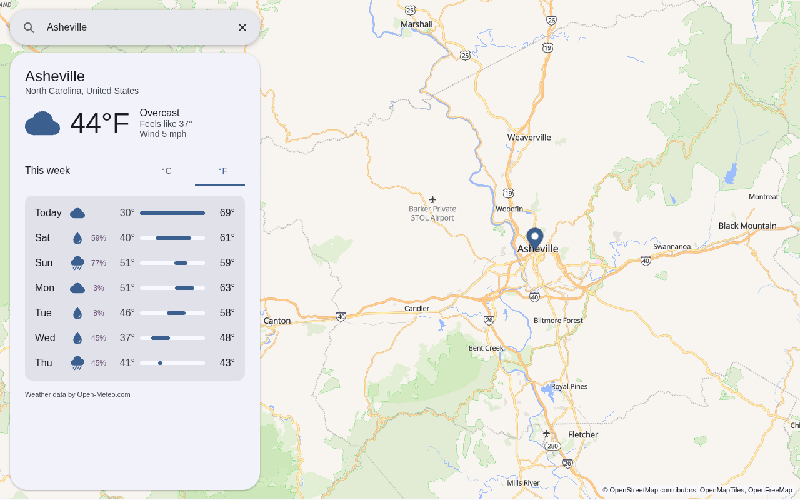
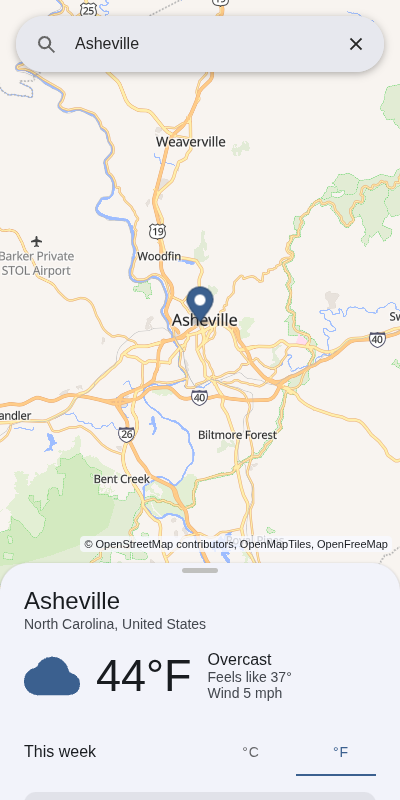

# ionic-weather

A weather app in Ionic and Angular, wrapped for Android and iOS with
Capacitor. One screen: a map with a search bar over it. Search for a place,
or press and hold on the map, and the forecast for the week appears.

**Live demo:** <https://calemccammon.github.io/ionic-weather/>

| Wide window                                                                                                 | Phone                                                                                         |
| ----------------------------------------------------------------------------------------------------------- | --------------------------------------------------------------------------------------------- |
|  |  |

It is one of six cross-platform builds of the same app, written to compare
the frameworks. The others are
[flutter-weather](https://github.com/calemccammon/flutter-weather),
[kmp-weather](https://github.com/calemccammon/kmp-weather),
[react-native-weather](https://github.com/calemccammon/react-native-weather),
[maui-weather](https://github.com/calemccammon/maui-weather) and
[capacitor-weather](https://github.com/calemccammon/capacitor-weather).
[android-weather](https://github.com/calemccammon/android-weather) is the
native Android build in Kotlin and Jetpack Compose, which goes further with
saved places, offline forecasts and a home-screen widget.

capacitor-weather is Capacitor without Ionic: a Vue app with Google's
Material Web components. This build uses Capacitor with Ionic's components
and Angular.

## What it does

- **Search as you type**, debounced; a late response to an older query never
  overwrites a newer one.
- **Pick a point** by pressing and holding on the map.
- **Forecast**: current conditions, then seven days with the chance of
  precipitation and a bar placing each day's low and high within the week's
  range.
- **Adapts to the window**: a draggable bottom sheet on a phone, a side panel
  from 840 px wide. The map keeps the chosen place clear of both.
- **Celsius or Fahrenheit**, switched from the forecast and saved between
  launches. The default follows the device's region.
- **Light and dark** themes from one seed colour, following the system. The
  map changes style with them.
- **Accessible**: screen readers read each forecast block as one sentence,
  loading and errors are announced, and the forecast's columns widen with the
  user's text size.
- **Errors**: a timeout, no connection, a refused request and an
  overloaded service each get their own message and a Try again button.

## Architecture

Clean Architecture in three layers. Dependencies point inward only: `data`
and `ui` import `domain`, and `domain` imports neither, nor any library.
`npm run lint` fails on an import that breaks this (the rules are in
`eslint.config.js`).

| Path              | What it holds                                                                                                                                                                                                                                                                                                 |
| ----------------- | ------------------------------------------------------------------------------------------------------------------------------------------------------------------------------------------------------------------------------------------------------------------------------------------------------------- |
| `src/app/domain`  | The app's own types (`Place`, `Forecast`, `WeatherCondition`, `Units`), the repository interfaces (`WeatherRepository` with its failure kinds, `SettingsRepository`), and the use cases (`SearchPlaces`, `GetForecast`, `GetUnits`, `SetUnits`) that hold the rules. Plain TypeScript: no Angular, no Ionic.     |
| `src/app/data`    | Open-Meteo: the wire-shaped models (`*-dto.ts`), their translation into domain types, and the repository implementation. Settings are kept with Capacitor's Preferences plugin.                                                                                                                                 |
| `src/app/l10n`    | All user-facing strings, screen-reader text included, in `messages.ts`, each marked with Angular's `$localize`.                                                                                                                                                                                                                  |
| `src/app/ui`      | `core` has the mapping from domain values to wording and icons. `home` has `models` (what the screen shows, already worded and rounded), `view-models` (call use cases and produce those models as signals) and `components` (render the models and never import the domain or data). The theme is in `src/theme`. |
| `src/app/di`      | `providers.ts` says which implementation stands behind each interface and how each use case is built. Outside tests, only `main.ts` imports it.                                                                                                                                                                 |
| `src/app/testing` | Fakes shared by the tests, which sit beside the code they test as `*.spec.ts`.                                                                                                                                                                                                                                  |

Each layer has its own model, with a mapping between them:

|              | Data                           | Domain       | UI                                                                         |
| ------------ | ------------------------------ | ------------ | -------------------------------------------------------------------------- |
| Type         | `ForecastDto`                  | `Forecast`   | `ForecastUiModel`                                                          |
| A day's high | `temperature_2m_max[1] = 64.3` | `high: 64.3` | `high: "64°"`, `barEnd: 0.75`                                              |
| Conditions   | `weather_code: 3`              | `'overcast'` | an icon name and `"Overcast"`                                              |
| A failure    | HTTP 400, a timeout            | `'rejected'` | `messages.failure.rejected`: "The weather service refused the request."    |

State is held by two view models, `HomeViewModel` and `SearchViewModel`. Each
is an Angular service exposing one read-only signal, so it can be tested
without rendering. Components take the state through inputs and report user
actions through outputs.

The domain, data and view-model code is close to
[react-native-weather](https://github.com/calemccammon/react-native-weather)'s,
which is TypeScript too. What differs is everything Angular and Ionic touch:
the components, dependency injection, localisation and the screen tests.

## Running

Ionic 9, Angular 22, Capacitor 8, Node 24. Targets: web, Android and iOS.

```sh
npm install
npm start               # the app in a browser, rebuilding on change
npm run build           # static site in www/
npm run build:android   # builds the site, copies it into android/ and builds a debug APK
```

The Android project in `android/` is generated by Capacitor and committed,
as Capacitor recommends. To run the APK, start the emulator with
`emulator -avd Pixel_API_36` and install
`android/app/build/outputs/apk/debug/app-debug.apk` with `adb install`, or
open `android/` in Android Studio. There is no `ios/` project yet: adding
and building one needs a Mac.

## Checks

```sh
npm run lint        # ESLint, the type check of the browser tests, and Prettier; `npm run lint:fix` fixes
npm run test:unit   # Vitest: domain, data, wording, UI models and view models
npm run test:e2e    # Playwright: the whole screen in a browser, at phone and wide sizes
```

The browser tests stub the weather service and the map style, so they need
no network. Run `npx playwright install chromium` once first.

`.github/workflows/ci.yml` runs these on pushes to `main` and on pull
requests, then builds the web app. On `main`, and on demand from the Actions
tab, it also builds an Android debug APK. Both builds are uploaded as
workflow artifacts.

`.github/workflows/pages.yml` builds the web app and publishes the live
demo. It runs only when started by hand from the Actions tab.

## Data and credits

- Place search and forecasts: [Open-Meteo](https://open-meteo.com/) (no key;
  free for non-commercial use; CC BY 4.0).
- Map: [OpenFreeMap](https://openfreemap.org/) styles and tiles (no key),
  from [OpenMapTiles](https://openmaptiles.org/) and
  © [OpenStreetMap](https://www.openstreetmap.org/copyright) contributors,
  drawn with [MapLibre GL JS](https://maplibre.org/).

## Known limits

- **English only.** All strings are in `messages.ts` and weekday names follow
  the app's locale, so adding a language means adding a translation file.
- **Places are not saved**: the chosen place is forgotten when the app
  closes. Only the choice of units is kept.
- **It looks like Ionic, not Material 3.** Ionic's components follow
  Material 2 on Android and the web, and Apple's style on iOS; the colours
  are the same Material 3 palette as the other builds.
- **Android and the web only so far.** iOS needs a Mac.

## Not built

Ideas that were considered and left out, roughly in the order they would be
worth doing:

- **Saved places** shown when the app opens.
- **Forecast for the current location**, which needs the location permission
  on each platform.
- **A second language**, to exercise the localisation set-up.
